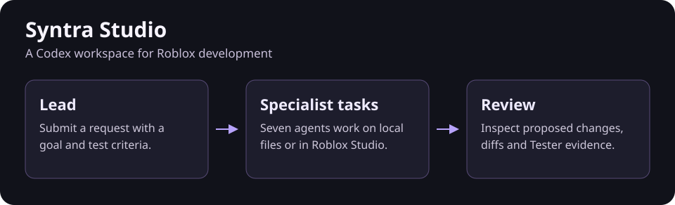

# Syntra Studio

Syntra Studio is a local-first workspace for building Roblox games with OpenAI Codex. Give the Lead a request, follow the tasks it assigns to seven specialist agents, and review proposed changes from one dashboard. You can work on local project files or connect Roblox Studio for live place edits and playtesting.



## Quick start

You’ll need **Node.js 22 or newer**, npm, and a ChatGPT account with Codex access or an OpenAI API key. For live place edits, install Roblox Studio on the Windows or macOS computer running the Syntra worker.

```sh
git clone https://github.com/farhajmaaz-eng/syntra.git
cd syntra
npm ci
cp .env.example .env
npm run local
```

On Windows PowerShell, use `Copy-Item .env.example .env` in place of `cp`. Open [http://127.0.0.1:3000](http://127.0.0.1:3000).

1. Open **Codex** and sign in. Set the project root to the directory that contains the files you want agents to work on.
2. Create or select a project in **Games**. For live Roblox Studio work, connect and pin a Studio instance using the steps below.
3. Submit a request in **Lead** or **Home**. Include the expected result and how it should be verified.
4. Track work in **Tasks**. Open **Review** to inspect proposed Studio operations and completed work. The **Codex** page also shows command and file-change approvals, session diffs, and token usage.

For a first request, try “Add a server-side checkpoint system to my obby. Keep the existing map and verify that players respawn at their latest checkpoint.”

## Connect Roblox Studio

1. Open your place in Roblox Studio and [enable the official Studio MCP server](https://create.roblox.com/docs/studio/mcp).
2. Open **Settings → Roblox Studio connection** in Syntra. Enter the command and arguments supplied by Roblox Studio, save them, then choose **Connect / reconnect**.
3. In **Games**, use **Discover Studios**, then add or update your project with the returned Studio ID. If Studio restarts and the ID changes, use **Review Studio switch** to confirm the replacement.

See [Studio connection recovery](docs/STUDIO_CONNECTION_RECOVERY.md) if a connection changes during a run.

## What’s in the workspace

- **Lead and Team** coordinate the work. Architect plans, Builder writes Luau, Frame works on UI, Scenic builds environments, Balance tunes progression, Tester checks results, and Codex handles focused local-repository tasks.
- **Tasks and Review** show dependencies, status, approval requests, and evidence. Review interrupted operations against the actual project or place before retrying.
- **Library** includes searchable Roblox Creator Documentation and Syntra playbooks. Add project references or build a brief for an agent. See the [library guide](library/README.md).

## Running and maintaining Syntra

`npm run local` launches the dashboard and a separate worker together. `npm run dev` uses an embedded worker. For a production build with the embedded worker, run `npm run build` followed by `npm run start`. If you run `npm run worker` independently, set `WORKER_EXTERNAL=1` for the dashboard and use the same data directory and worker port for both processes.

Workspace data and Codex credentials are stored locally in `.data/` by default. Set `SYNTRA_DATA_DIR` to move that directory. Upgrading installations can still read the previous directory setting and database filename. New workspaces use `syntra.sqlite`. Stop Syntra before backing it up, and keep it out of version control. Use the dashboard on a trusted machine. Codex billing is handled by OpenAI, and Syntra displays token usage.

## Development checks

```sh
npm run typecheck
npm test
npm run build
```

These checks run without a browser. Automated integration tests use local fixtures for Codex and Roblox Studio MCP. Live playtesting requires your own Roblox Studio instance and a signed-in Codex session.

For implementation details, see the [Codex integration guide](docs/CODEX_INTEGRATION.md).
